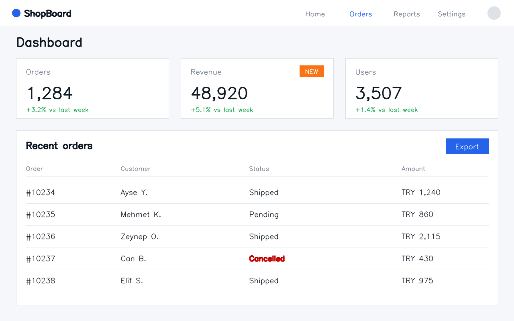
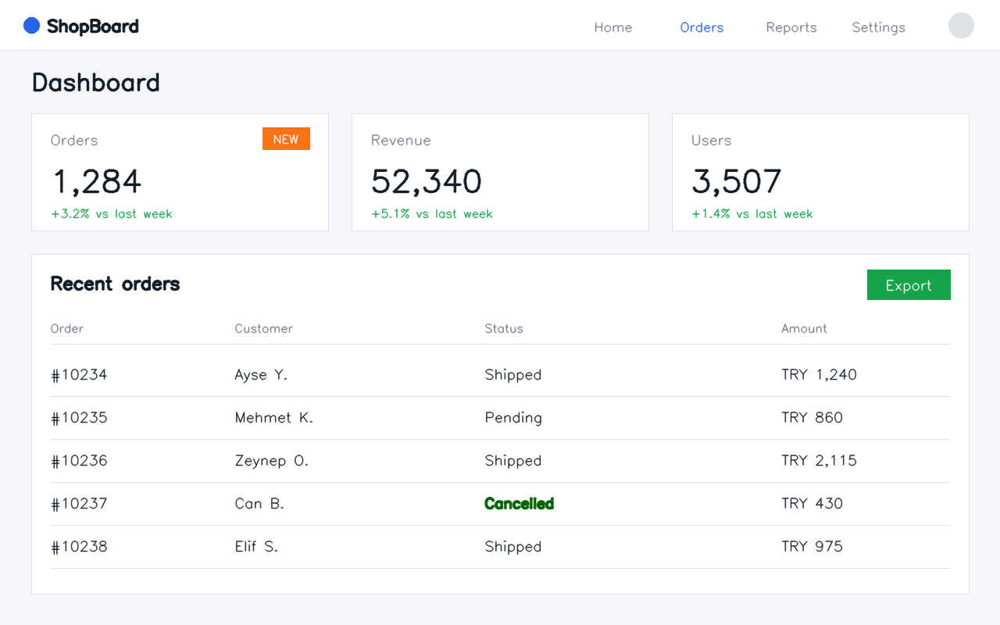

# Visual Difference Analysis

**Image Processing course project · Görüntü İşleme dersi projesi**

| Student / Öğrenci | Student ID / Öğrenci No |
|---|---|
| Muhammed Umut Varol | 220218040 |
| Zeynep Özdemir | 220218038 |

[Türkçe](#türkçe) · [English](#english)

| Earlier version / Önceki sürüm | Updated version / Güncel sürüm |
|---|---|
|  |  |

---

## Türkçe

### Proje nedir?

Bir web sitesi güncellendiğinde butonlar kayabilir, yazılar taşabilir, renkler değişebilir.
Her farkı gözle tek tek kontrol etmek zaman alır ve küçük değişiklikler kolayca gözden kaçar.

Bu proje, aynı web sayfasının **önceki** ve **güncel** sürümlerinin ekran görüntülerini
karşılaştırır ve değişen alanları **bounding box** (çerçeve) ile işaretler. Bu yönteme
*görsel regresyon testi* (visual regression testing) denir.

### Neyi amaçlıyoruz?

- Görsel değişiklikleri kolayca fark edilir hale getirmek ve inceleme sürecini desteklemek
- Görüntü işleme kavramlarını gerçek bir yazılım problemine uygulamak
- Araç değişen alanları bulur; değişikliğin **hata mı yoksa bilerek yapılmış bir güncelleme mi**
  olduğuna kullanıcı karar verir

### Ne yararı olacak?

- **Zaman kazandırır:** İki ekran görüntüsünü gözle satır satır karşılaştırmak yerine farklar
  saniyeler içinde işaretlenir.
- **Küçük değişiklikleri kaçırmaz:** Tek bir rakamın değişmesi ya da bir butonun renk tonunun
  değişmesi bile yakalanır.
- **Hataları erken yakalar:** Bir güncellemeden sonra yanlışlıkla bozulan bir tasarım, kullanıcılar
  görmeden fark edilir.
- **İncelemeyi kolaylaştırır:** Kişi tüm sayfaya değil, sadece işaretli alanlara bakar.

### Nasıl çalışıyor?

```
Piksel farkı → Eşikleme → Morfoloji → Kontur → Bounding box
```

1. **Piksel farkı:** İki görüntü piksel piksel karşılaştırılır (`cv2.absdiff`). Fark mavi, yeşil
   ve kırmızı kanallarda ayrı ayrı alınır. Görüntüyü önce griye çevirmek bazı renk
   değişimlerini gizleyebilir; örneğin koyu kırmızı ile koyu yeşil aynı gri tona düşer.
2. **Eşikleme:** Fark belirli bir değerin üstündeyse piksel "değişti" (beyaz), değilse
   "değişmedi" (siyah) olarak işaretlenir (`cv2.threshold`).
3. **Morfoloji:** Birbirine yakın değişen pikseller tek bir bölgede birleştirilir. Örneğin bir
   sayının rakamları tek bölge olur.
4. **Kontur:** Her değişen bölgenin sınırı bulunur (`cv2.findContours`).
5. **Bounding box:** Her bölgenin etrafına bir çerçeve çizilir (`cv2.boundingRect`).

İlk sürümde iki ekran görüntüsünün **aynı boyutta** olması gerekir.

### Kullandığımız teknolojiler

| Teknoloji | Ne için kullanıyoruz |
|---|---|
| **Python** | Projenin programlama dili |
| **OpenCV** | Piksel farkı, eşikleme, morfoloji ve kontur bulma |
| **NumPy** | Görüntüleri sayı dizileri olarak işlemek |
| **Streamlit** | Basit bir web arayüzü: iki görüntüyü yükle, farkları gör |
| **Visual Studio Code** | Geliştirme ortamı |
| **Git / GitHub** | Sürüm kontrolü ve ortak çalışma |

### Kurulum ve çalıştırma

Python **3.12 veya üstü** gerekir.

```bash
git clone https://github.com/UmutVarol/visual-difference-analysis.git
cd visual-difference-analysis
python3 -m venv .venv
.venv/bin/pip install -r requirements.txt
.venv/bin/streamlit run app.py
```

Windows'ta `.venv/bin/` yerine `.venv\Scripts\` kullanın.

Örnek görüntü çiftini yeniden üretmek için: `.venv/bin/python samples/make_samples.py`

### Proje durumu

- [x] Ortam kurulumu
- [x] Görüntüleri okuma ve boyut kontrolü
- [x] Piksel farkı ve eşikleme
- [ ] Morfoloji, kontur ve bounding box
- [ ] Streamlit arayüzü
- [ ] Son kontrol

---

## English

### What is this project?

When a website is updated, buttons can shift, text can overflow and colors can change.
Checking every difference by hand takes time, and small changes are easy to miss.

This project compares screenshots of an **earlier** and an **updated** version of the same web
page and highlights the changed areas with **bounding boxes**. This approach is known as
*visual regression testing*.

### What do we aim to achieve?

- Make visual changes easier to spot and support the review process
- Apply image processing concepts to a practical software problem
- The tool finds the changed areas; the user decides whether each change is a **defect or an
  intended update**

### Why is it useful?

- **Saves time:** Instead of comparing two screenshots line by line, the differences are marked
  in seconds.
- **Does not miss small changes:** Even a single changed digit or a slightly different button
  color is detected.
- **Catches defects early:** A design that broke by accident during an update is noticed before
  users see it.
- **Makes review easier:** The reviewer looks only at the marked areas, not the whole page.

### How does it work?

```
Pixel differencing → Thresholding → Morphology → Contours → Bounding boxes
```

1. **Pixel differencing:** The two images are compared pixel by pixel (`cv2.absdiff`). The
   difference is taken separately for the blue, green and red channels. Converting to
   grayscale first can hide some color changes; for example, dark red and dark green map to the
   same gray value.
2. **Thresholding:** A pixel is marked as "changed" (white) if its difference is above a set
   value, otherwise as "unchanged" (black) (`cv2.threshold`).
3. **Morphology:** Changed pixels that are close together are merged into one region, so the
   digits of a number become a single region.
4. **Contours:** The outline of each changed region is found (`cv2.findContours`).
5. **Bounding boxes:** A box is drawn around each region (`cv2.boundingRect`).

In the first version, both screenshots must have **identical dimensions**.

### Technologies we use

| Technology | What we use it for |
|---|---|
| **Python** | Programming language of the project |
| **OpenCV** | Pixel differencing, thresholding, morphology and contour detection |
| **NumPy** | Working with images as arrays of numbers |
| **Streamlit** | A simple web interface: upload two images, see the differences |
| **Visual Studio Code** | Development environment |
| **Git / GitHub** | Version control and collaboration |

### Setup and run

Requires Python **3.12 or newer**.

```bash
git clone https://github.com/UmutVarol/visual-difference-analysis.git
cd visual-difference-analysis
python3 -m venv .venv
.venv/bin/pip install -r requirements.txt
.venv/bin/streamlit run app.py
```

On Windows, use `.venv\Scripts\` instead of `.venv/bin/`.

To regenerate the sample image pair: `.venv/bin/python samples/make_samples.py`

### Project status

- [x] Environment setup
- [x] Image loading and size check
- [x] Pixel differencing and thresholding
- [ ] Morphology, contours and bounding boxes
- [ ] Streamlit interface
- [ ] Final review
